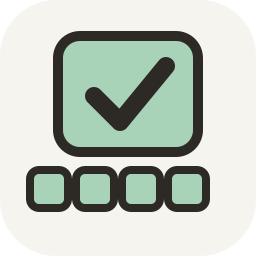

<p align="center">
  
</p>

<h1 align="center">Non-Zero</h1>

<p align="center">
  <em>Do one thing today. Then do it again tomorrow.</em>
</p>

<p align="center">
  <a href="LICENSE"></a>
  
  
</p>

A self-hosted habit tracker for your phone and laptop, built on the "no zero days" idea: a tiny win beats a perfect plan.

- **Month sheet** on a laptop, like a paper tracker. **Day sheet** on a phone.
- Tick-off and amount habits ("8 glasses", "20 minutes")
- Streaks, a year heatmap and weekly bars
- Profiles with their own PINs
- Works offline, with optional push reminders that skip what you've already done

## Run it

```bash
cp .env.example .env
```

```bash
docker build -t non-zero .
```

```bash
docker run -d --name non-zero --restart unless-stopped --env-file .env -p 3210:3210 -v non-zero-data:/app/data non-zero
```

Open http://localhost:3210 and pair the device with your `ADMIN_KEY`. Leave it empty and one is generated in `data/admin-key.txt`.

Without Docker, use Node 24 and run `npm install`, `npm run build`, then `npm start`.

To install it on a phone, serve it over HTTPS with [Tailscale](https://tailscale.com) or a Cloudflare Tunnel, then choose "Add to Home Screen".

## Your data

One SQLite file plus two keys, all in the `data/` folder. Back that up and you've backed up everything. Each profile can also export and import JSON from Settings.

## Contribute

Fastify + SQLite in `server/`, React in `web/`, shared streak logic in `shared/`. See [CONTRIBUTING.md](CONTRIBUTING.md), and report vulnerabilities as described in [SECURITY.md](SECURITY.md).

## License

[MIT](LICENSE)
